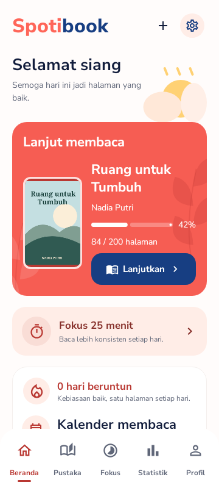
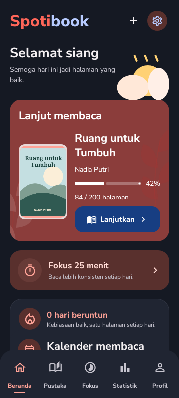
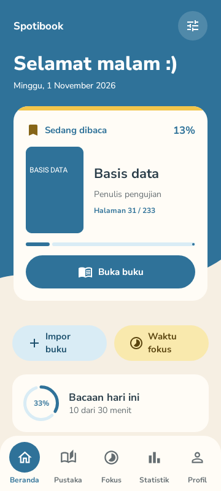
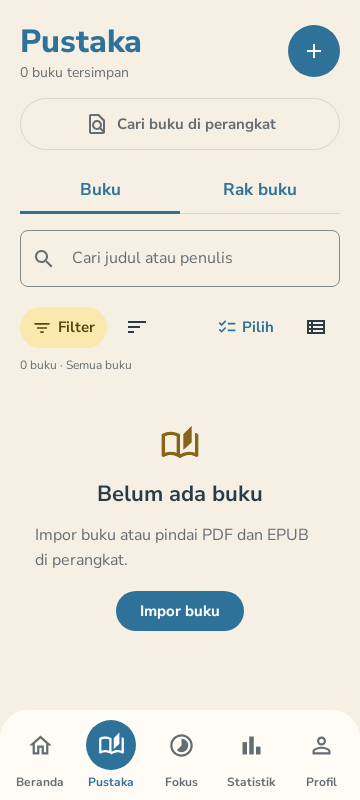
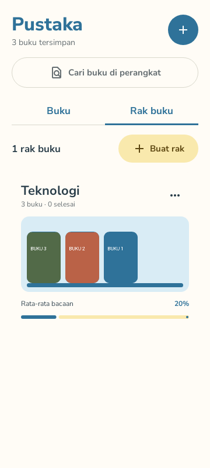
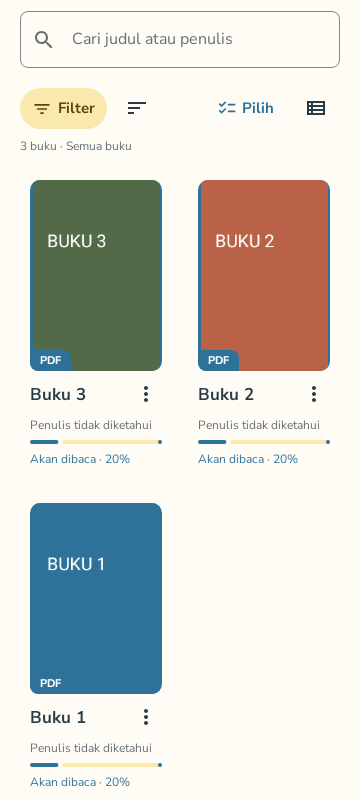
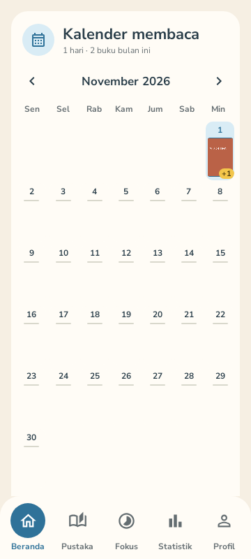
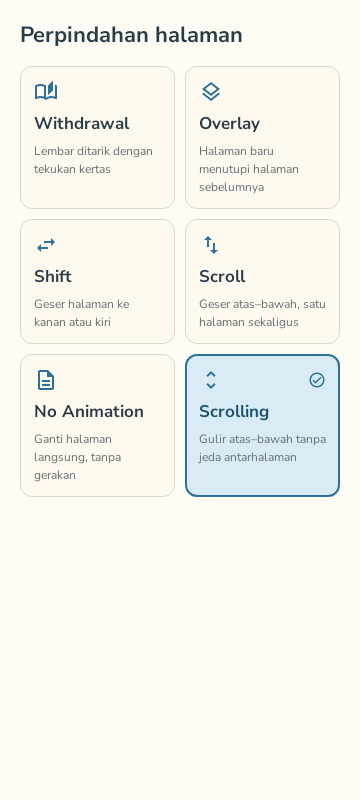
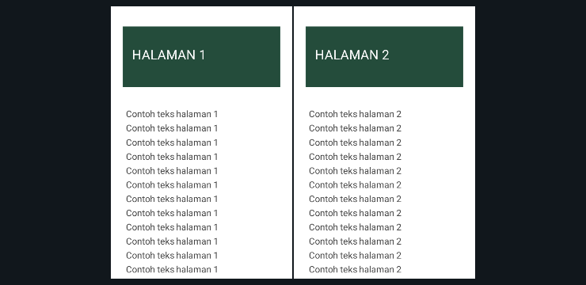
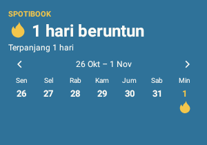

# Tampilan Spotibook

[Kembali ke README](../README.md)

## Update 1.7.0 — Beranda Coral baru dan mode gelap

| Terang | Gelap |
| --- | --- |
|  |  |

Pilih tema lewat Profil → Tema aplikasi. Untuk suara Indonesia offline, buka buku dan tekan ikon headphone. Semua gambar memakai data pengujian. Galeri di bawah mendokumentasikan fitur yang sudah ada; beberapa gambar masih menampilkan palet versi sebelumnya.

Spotibook punya lima halaman utama: **Beranda, Pustaka, Fokus, Statistik, dan Profil**. Galeri ini memperlihatkan beberapa tampilan yang sudah tersedia dari pengujian UI, disertai cara menggunakannya.

Semua gambar memakai data contoh dari pengujian, bukan data pengguna atau buku bawaan aplikasi. Gambar dibuat lewat pengujian UI di komputer, bukan tangkapan layar HP. Contoh halaman PDF memakai renderer fixture pengujian; hasil render dokumen asli perlu diperiksa pada perangkat.

## Beranda — lanjutkan bacaan

Beranda menampilkan buku yang sedang dibaca, posisi terakhir, dan progresnya. Tekan **Buka buku** untuk melanjutkan bacaan. Kartu **Bacaan hari ini** menunjukkan waktu membaca dibanding target harian; pada contoh, sudah tercatat 10 dari target 30 menit.

Tombol **Impor buku** membuka pemilih file, sedangkan **Waktu fokus** membuka timer. Bagian kalender dan streak tersedia saat halaman digulir. Navigasi bawah dipakai untuk berpindah ke Pustaka, Fokus, Statistik, dan Profil.

## Pustaka — masukkan dan cari buku

Ini tampilan saat belum ada buku. Tekan **+** atau **Impor buku** untuk memilih PDF, EPUB, TXT, atau HTML. **Cari buku di perangkat** memindai PDF dan EPUB di penyimpanan yang bisa diakses, dengan izin tambahan bila diperlukan.

Setelah ada buku, kolom pencarian bisa dipakai untuk mencari judul atau penulis. Tombol **Filter** menyaring status baca, tombol urutan mengatur susunan buku, dan ikon tampilan mengganti daftar atau grid. **Pilih** digunakan untuk tindakan pada beberapa buku sekaligus.

## Rak buku — kelompokkan koleksi

Tab **Rak buku** berisi kelompok buku buatan sendiri, misalnya berdasarkan topik, kuliah, atau daftar bacaan. Setiap rak menampilkan sampul, jumlah buku, jumlah yang selesai, dan rata-rata progres membaca. Contoh di atas berisi satu rak bernama **Teknologi**.

Tekan **Buat rak** untuk menambahkan rak, lalu pilih buku di Pustaka dan gunakan **Masukkan ke rak**. Satu buku bisa masuk ke lebih dari satu rak. Menghapus rak tidak menghapus bukunya dari pustaka.

### Isi rak

Membuka rak menampilkan buku di dalamnya. Tampilan ini sedang digulir ke daftar buku: setiap kartu memperlihatkan sampul, format, judul, penulis, status, dan progres. Ketuk buku untuk membaca, atau gunakan menu buku untuk tindakan lain.

**Keluarkan dari rak** hanya menghapus keanggotaan rak tersebut. **Hapus dari pustaka aplikasi** menghapus salinan di aplikasi serta bookmark dan catatannya, sementara file asli dan statistik membaca tetap disimpan.

## Kalender — lihat bacaan per tanggal

Kalender mencatat buku yang dibaca pada tiap tanggal dengan sampulnya. Jika beberapa buku dibaca pada hari yang sama, ada penanda jumlah tambahan seperti **+1** pada contoh. Tekan tanggal untuk melihat daftar buku dan durasi membaca hari itu; panah bulan digunakan untuk melihat periode lain.

Catatan ini berasal dari aktivitas pembaca. Menjalankan timer Fokus saja tidak menambah waktu baca.

## Pembaca PDF — pilih cara berpindah halaman

Panel pembaca menyediakan enam mode perpindahan halaman:

| Mode | Perilaku |
| --- | --- |
| Withdrawal | Perpindahan dengan efek tekukan tepi kertas. |
| Overlay | Halaman baru menutupi halaman sebelumnya. |
| Shift | Halaman bergeser ke kanan atau kiri. |
| Scroll | Geser vertikal satu halaman sekaligus. |
| No Animation | Halaman diganti langsung tanpa animasi. |
| Scrolling | Gulir vertikal terus-menerus antarahalaman. |

Pengaturan pembaca juga mencakup tema terang, sepia, atau gelap, kecerahan, orientasi, margin, dan pilihan menyesuaikan lebar atau seluruh halaman. PDF mendukung zoom, bookmark, dan catatan halaman. Pengaturan huruf dan sorotan teks digunakan pada EPUB/TXT/HTML; isi huruf di halaman PDF tidak diubah.

### Dua halaman saat landscape

Saat landscape, pembaca PDF menampilkan dua halaman berdampingan. Perpindahan relatif maju atau mundur mengikuti pasangan halaman. Jika jumlah halaman ganjil, halaman terakhir ditampilkan sendiri di tengah.

Gambar di atas memakai halaman contoh pengujian. Tampilan awal menyesuaikan lebar dan tinggi pasangan halaman; zoom dan geser bisa digunakan untuk melihat bagian yang lebih dekat.

## Widget — cek streak dari layar utama

Widget streak menampilkan jumlah hari membaca beruntun, rekor terpanjang, dan kalender mingguan. Ikon api menandai tanggal yang memenuhi minimum membaca. Tombol panah dipakai untuk melihat minggu lain.

Selain streak, ada widget **target harian**, **buku aktif**, dan **akses cepat membaca**. Tambahkan dari menu widget launcher Android, atau gunakan **Pasang widget** pada kartu streak. Ukuran dan penempatannya bergantung pada launcher perangkat.

## Fokus, Statistik, dan Profil

Tiga halaman ini belum memiliki screenshot di galeri, tetapi alur penggunaannya sebagai berikut:

| Halaman | Untuk apa | Cara pakai |
| --- | --- | --- |
| Fokus | Mengatur sesi membaca dengan batas waktu. | Pilih durasi dan buku bila diperlukan, lalu mulai timer. Timer bisa dijeda atau dilanjutkan. Atur notifikasi selesai, nada bawaan, MP3 sendiri, atau senyap pada pengaturan Fokus. |
| Statistik | Melihat waktu baca, sesi, progres target, buku selesai, dan kebiasaan membaca. | Pilih rentang hari ini, minggu, bulan, tahun, atau semua. Statistik diisi dari aktivitas membaca yang tercatat. |
| Profil | Mengatur tampilan, target, pengingat, serta pemindahan data. | Atur preferensi di sini. Untuk pindah perangkat, buat cadangan lokal dengan **Sertakan berkas buku**, lalu pulihkan cadangan pada perangkat tujuan. |

Tidak ada sinkronisasi cloud. Cadangan ZIP tidak dienkripsi, jadi simpan di tempat pribadi. Pengingat dan alarm Fokus dapat dipengaruhi izin notifikasi serta pengaturan baterai perangkat.
